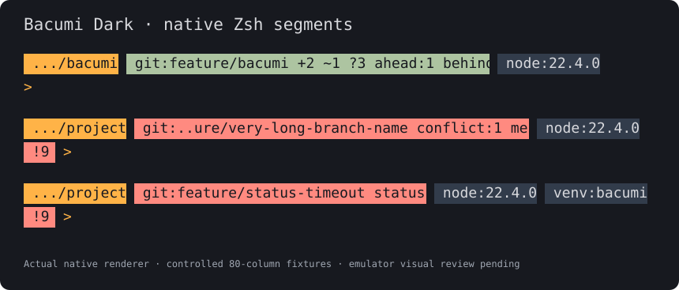
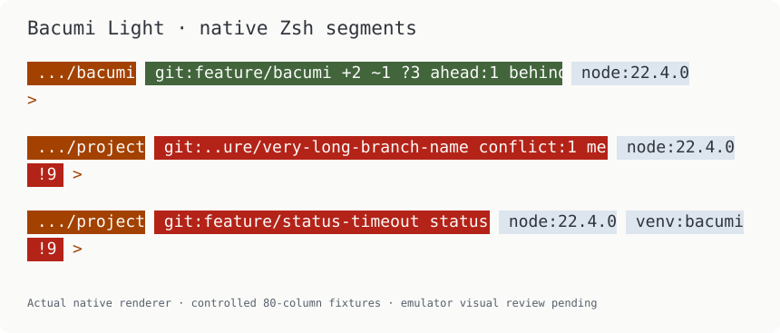
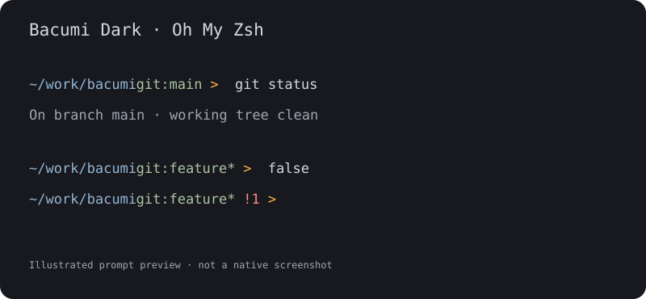
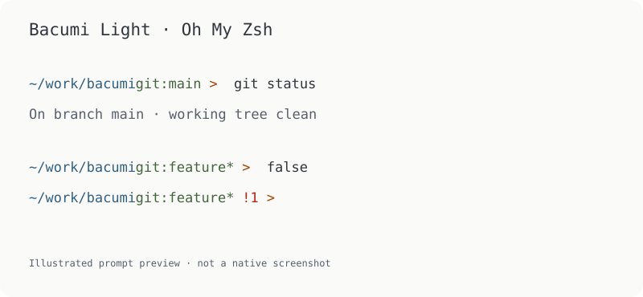

<div align="center">
  <picture>
    <source media="(prefers-color-scheme: dark)" srcset="assets/icons/icon-dark-128.png">
    
  </picture>
  <h1>Bacumi for Oh My Zsh</h1>
  <p>A focused shell prompt, in Dark and Light.</p>
  <p>
    <a href="https://github.com/bacumi-tech/bacumi-oh-my-zsh-theme/releases/tag/v0.3.3">Download 0.3.3 preview</a> ·
    <a href="#installation">Installation</a> ·
    <a href="BRAND.md">Brand and icons</a> ·
    <a href="LICENSE">MIT license</a>
  </p>
</div>

**0.3.3 preview.** Clears stale failures on empty Enter in the Bacumi Dark/Light
developer prompts. Download the ZIP below or install from the Git checkout.

Bacumi brings focused developer information to Zsh: your directory, detailed Git
state, relevant runtimes and command results. Dark and Light follow the Bacumi
palette. Choose a two-line developer prompt, compact layout or the original
lightweight prompt; all work with a standard font.

**Preview release.** Automated prompt and installer checks run on macOS and Linux.
WSL-specific visual review remains pending; see [validation](VALIDATION.md).

## Native developer prompt preview

### Bacumi Dark



### Bacumi Light



These images are generated by the actual native renderer using controlled
80-column test scenarios: changed Git files, a merge failure and unavailable
Git status. They are not native emulator screenshots. The build checks rerender
them from code; the font, window surface and ANSI palette still depend on your
terminal. Information is contextual: Git appears inside repositories, and
runtimes appear for relevant projects or active environments.

## Palette and lightweight preview

<table>
  <tr><th>Bacumi Dark</th><th>Bacumi Light</th></tr>
  <tr>
    <td width="50%"></td>
    <td width="50%"></td>
  </tr>
</table>

Illustrated prompt previews, not native terminal screenshots.

| Indicator | Meaning |
| --- | --- |
| Directory | Current path, shortened to fit the window |
| `git:main` | Current Git branch |
| `+2 ~1 ?3` | 2 staged, 1 unstaged and 3 untracked files |
| `conflict:1` | 1 conflicted file |
| `ahead:2 behind:1` | Commit counts against the locally known upstream |
| `merge` / `rebase` | Git operation in progress |
| `node:22…` | Active runtime version for a relevant project |
| `3.2s` | Previous command took at least two seconds |
| `*` | Any changes, in the original lightweight prompt |
| `git:@abc1234` | Detached HEAD, identified by commit prefix |
| `!1 command failed` | The previous command failed; its exit code is preserved |
| `!127 command not found` | Zsh's conventional summary for exit code 127 |
| `!130 interrupted` | Zsh's conventional summary for an interrupted command |

The developer prompt adds a short summary to the exit code: `cannot execute`
for 126, `command not found` for 127, `interrupted` for 130, `terminated` for
143, and `command failed` for other failures. These are exit-code conventions,
not a diagnosis of an application's error. The full message stays in the
command's original output; the theme does not capture or repeat it. A successful
command clears the badge. Compact layouts use a second line when the summary
and essential Git state cannot fit together. Extremely narrow windows shorten
the summary. The original lightweight prompt retains its numeric `!1` display.

## Installation

### Requirements

- macOS, Linux or WSL with **Zsh 5.8+** and **Oh My Zsh** already installed.
- **Git 2.20+** for Git indicators; the prompt works without Git.

Installation from ZIP requires no Git, special font or package manager.

### 1. Download and extract

Download [bacumi-oh-my-zsh-theme-0.3.3.zip](https://github.com/bacumi-tech/bacumi-oh-my-zsh-theme/releases/download/v0.3.3/bacumi-oh-my-zsh-theme-0.3.3.zip)
from the [GitHub release](https://github.com/bacumi-tech/bacumi-oh-my-zsh-theme/releases/tag/v0.3.3).
Extract the ZIP and open a terminal in the folder containing `install.sh`.

To verify the ZIP first, download `SHA256SUMS` from the same release into the ZIP's
folder and run:

```sh
shasum -a 256 -c SHA256SUMS
```

On Linux, you can use `sha256sum -c SHA256SUMS` instead.

### 2. Install the themes

```sh
sh install.sh
```

The default destination is `~/.oh-my-zsh/custom/themes/bacumi`. The script also
respects exported `ZSH_CUSTOM` and `ZSH` locations. For a custom directory that is
configured only inside `.zshrc`, pass its actual path:

```sh
sh install.sh --custom-dir '/path/to/oh-my-zsh/custom'
```

The installer includes both Developer and Lightweight prompts, each in Dark and
Light. **Developer is recommended** for detailed Git and runtime information;
Lightweight keeps only directory, basic Git state and the last failure. You
choose the active theme in your configuration; `.zshrc` is preserved.

### 3. Select a Developer appearance (recommended)

Back up your configuration before editing it:

```sh
cp -n ~/.zshrc ~/.zshrc.before-bacumi
```

In `~/.zshrc`, replace the current `ZSH_THEME` assignment with one of these
**before** the line that sources Oh My Zsh:

```zsh
ZSH_THEME="bacumi/bacumi-developer-dark"
```

For a light terminal background, use:

```zsh
ZSH_THEME="bacumi/bacumi-developer-light"
```

Keep **one** `ZSH_THEME` assignment. Choose Dark or Light to match your terminal
background. These Developer themes provide the detailed prompt shown above.

For the optional **Lightweight** prompt, use one of these instead:

```zsh
ZSH_THEME="bacumi/bacumi-dark"   # Lightweight Dark
# Or: ZSH_THEME="bacumi/bacumi-light"  # Lightweight Light
```

Existing selections keep their layout after an update; installing files does
not select a different prompt. The installer safely upgrades the original
three-file installation.

Open a new terminal window. In a Git repository, the prompt should display your
branch. Run `false` to check that `!1` appears in the next prompt.

**Switching from Powerlevel10k:** disable the entire instant-prompt block
near the top of `.zshrc`, including its `if` and `fi`, and the line sourcing
`.p10k.zsh`. The cached instant prompt can still initialize Powerlevel10k even
after changing `ZSH_THEME`. Keep your old configuration so you can switch back.

Check for remaining initialization without sourcing or editing the file:

```sh
sh install.sh --check-config
```

The check returns 1 when a possible Powerlevel10k initialization is found.
Your Bacumi configuration can keep the `git` and `extract` plugins:

```zsh
export ZSH="$HOME/.oh-my-zsh"
ZSH_THEME="bacumi/bacumi-developer-dark"
plugins=(git extract)
source "$ZSH/oh-my-zsh.sh"
```

For isolated installation checks, use `--custom-dir` with a temporary path.
The installer leaves your normal shell configuration unchanged.

### Install from a Git checkout

```sh
git clone https://github.com/bacumi-tech/bacumi-oh-my-zsh-theme.git
cd bacumi-oh-my-zsh-theme
sh install.sh
```

Then select the theme as above. The installed files are independent of the
checkout; after `git pull`, rerun `sh install.sh` to update them.

## Optional step: install the font

The prompt works without a special font. For optional icons, from the extracted
release folder run:

```sh
sh install-font.sh
```

This optional step requires `curl` and `shasum` or `sha256sum` (included on
macOS and common Linux installations). It downloads four pinned **MesloLGS NF**
faces over HTTPS and verifies every
SHA-256 before installation. It installs per user into `~/Library/Fonts` on
macOS, or `${XDG_DATA_HOME:-~/.local/share}/fonts` on Linux. The font retains its
[upstream license](fonts/LICENSE-MesloLGS-NF.txt), [Apache 2.0 license](fonts/Apache-2.0.txt)
and [copyright notices](fonts/NOTICE.txt). No font binaries ship in the ZIP.

Select **MesloLGS NF** in Apple Terminal's **Settings → Profiles → Font**, or
iTerm2's **Settings → Profiles → Text → Font**, then enable `BACUMI_PROMPT_ICONS=1`
before loading the developer theme. Font selection is manual. Under WSL with
Windows Terminal, use the Windows companion's `Install-Font.ps1` on the Windows
host, because Windows Terminal renders with Windows fonts.

To remove only fonts owned by this installer:

```sh
sh install-font.sh --uninstall
```

Matching pre-existing fonts stay unowned and are retained. Modified or conflicting
files stop installation/removal. A custom font directory can be passed with
`--font-dir PATH`; use the same path when uninstalling. `--source-dir PATH`
and `--manifest PATH` support offline verification and isolated contributor tests.
Only use trusted manifests; the bundled manifest pins the reviewed upstream files.

## Customize

Place optional settings in `.zshrc` before Oh My Zsh is sourced:

```zsh
BACUMI_COLOR_MODE=auto  # Detect truecolor; otherwise use ANSI colors
# BACUMI_COLOR_MODE=truecolor
# BACUMI_COLOR_MODE=ansi
# BACUMI_COLOR_MODE=none
# BACUMI_SHOW_GIT=0     # Disable Git checks in large repositories
# BACUMI_GIT_DETAILS=0  # Omit file counts and untracked scanning
# BACUMI_PROMPT_LAYOUT=compact
# BACUMI_PROMPT_ICONS=1 # After selecting MesloLGS NF
# BACUMI_SHOW_RUNTIMES=0
# BACUMI_RUNTIME_CACHE_SECONDS=300
```

`TERM=dumb` or a nonempty `NO_COLOR` always uses plain text. ANSI mode follows your terminal's palette;
truecolor mode uses the exact Bacumi prompt colors. Choose the appearance that
matches your terminal background; the prompt does not change that background.
A window at least 40 columns wide is recommended.

The theme sets the left prompt and clears the right prompt. The developer
variant adds native command-start/end hooks for timing; reloading does not
duplicate its hooks. For coordinated output under WSL, pair it with
[Bacumi for Windows Terminal](https://github.com/bacumi-tech/bacumi-windows-terminal-theme).

## Update and uninstall

**Update:** run the installer from a newer release, or pull your Git checkout
and rerun the installer. Installed files with local edits are protected; back
up or move your custom copy before replacing it. Use a separate theme directory
for personal modifications.

**Uninstall:** restore your previous `ZSH_THEME` in `.zshrc`, then run this from
an extracted release or source checkout:

```sh
sh install.sh --uninstall
```

Pass the same `--custom-dir` if you used one. Removal preserves unrelated themes.
Open a new shell afterward.

## Brand and artwork

Both terminal projects use Bacumi Brand v1.0's approved editor palette. Original
[Dark/Light product icons](assets/icons/) are supplied as SVG masters and
transparent PNGs from 16 to 1024 px, with [provenance](assets/icons/provenance.json).
They are available for documentation, listings and shortcuts; the installer
leaves your terminal application's icon as configured.

Read [BRAND.md](BRAND.md) for color roles, icon rationale and reproduction details.

## Development

<details>
<summary>Build, verify and contribute</summary>

Use a source checkout with Python 3.10+, Zsh 5.8+ and Git 2.28+ for the test
fixtures. Standard checks use no third-party Python packages or private repositories.

```sh
python3 scripts/build.py --check
python3 scripts/build-developer-preview.py --check
python3 scripts/build-icons.py --check
python3 scripts/check-brand.py
sh -n install.sh install-font.sh
zsh -n bacumi-dark.zsh-theme bacumi-light.zsh-theme lib/prompt.zsh
python3 -m unittest discover -s tests -v
python3 scripts/package.py
python3 scripts/check-package.py
python3 scripts/benchmark-prompt.py
```

Set `BACUMI_OMZ_DIR` to a real Oh My Zsh checkout to also run framework-loading
tests; CI supplies a pinned checkout on macOS and Linux.

Edit `palette.json`, then run `python3 scripts/build.py` to regenerate entry
points and lightweight illustrations. Regenerate developer captures with
`python3 scripts/build-developer-preview.py` (Zsh required). Brand changes require review of both appearances.
Regenerate icon SVGs with `python3 scripts/build-icons.py`; optional PNG export
uses `python3 scripts/export-icons.py` with PyMuPDF in the contributor environment.
Committed PNGs require no renderer to use or verify.

See the [validation record](VALIDATION.md), [changelog](CHANGELOG.md) and
[contribution guide](CONTRIBUTING.md).

</details>

## Support and license

[Open an issue](https://github.com/bacumi-tech/bacumi-oh-my-zsh-theme/issues)
with your operating system, Zsh/Oh My Zsh versions, selected appearance and a
non-sensitive example.

Themes, palette, code, documentation and original product icons are covered by
the [MIT License](LICENSE). Bacumi names identify this project; trademark rights
and endorsement of forks are not granted. The theme makes no runtime network
requests and collects no telemetry. The optional font installer accesses only the
explicit download URLs; its downloaded font retains its upstream license.

Built using [Oh My Zsh's custom theme mechanism](https://github.com/ohmyzsh/ohmyzsh/wiki/Customization)
and [Zsh prompt expansion](https://zsh.sourceforge.io/Doc/Release/Prompt-Expansion.html).
